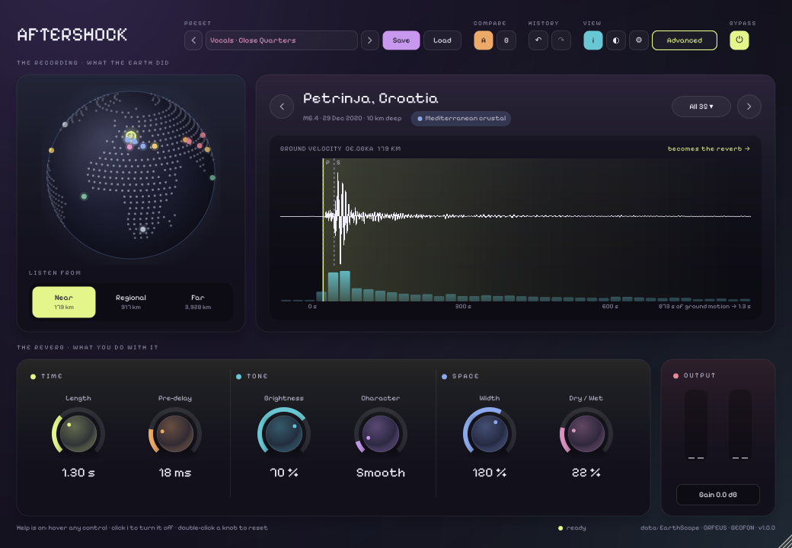

# Aftershock

A convolution reverb whose impulse responses come from real earthquake recordings.

When an earthquake happens, a seismometer first records the P wave, then the S wave, then
surface waves, and then the **coda**: energy that has scattered through the crust and dies
away slowly, high frequencies first. That coda behaves much like the tail of a room reverb.
Aftershock compresses real recordings of it into reverb length and convolves your audio with them.

The plugin ships with a curated pack of real broadband seismograms from earthquakes in nine
tectonic settings, each recorded at up to three distances. Everything you hear can be traced back
to a specific station, network and earthquake shown in the interface.



**Download:** installers for macOS and Windows are on the [Releases page](https://github.com/sofiavallejob/aftershock/releases),
with the [manual (PDF)](https://github.com/sofiavallejob/aftershock/releases/latest/download/Aftershock-Manual.pdf).
**Listen:** [sound examples](examples/index.html), dry and processed.

## Features

- 35 earthquakes in nine tectonic settings, each recorded at up to three distances (80 real seismograms)
- Simple view (rotating globe, seismogram, six knobs) and advanced view (map, three components, IR spectrogram, coda fingerprint, every parameter)
- 28 factory presets for vocals, drums, guitar and keys, synths and pads, mixing and sound design; your own presets, favourites, search, import
- A/B compare, undo and redo, output gain, meters, zero latency
- Dark, light and match-system themes, window size 75 to 200 %, three text sizes
- Accessibility: screen readers (VoiceOver, Narrator, NVDA) with spoken values, full keyboard control, high contrast, colour-blind palettes, reduced motion
- Help on hover for every control, and a "How it works" page inside the plugin
- VST3, AU and Standalone on macOS (universal); VST3 and Standalone on Windows (x64)

## What is in this repository

| Folder | What it is |
|---|---|
| `plugin/` | The JUCE plugin (VST3, AU, Standalone) and `aftershock_render`, a command-line IR renderer |
| `pipeline/` | Python pipeline that builds the earthquake pack from FDSN data centres |
| `docs/` | The manual (PDF and its generator), how the mapping works, what is physical and what is a design choice |
| `examples/` | Sound examples (MP3) and a web page to compare dry and processed |
| `installer/` | macOS .pkg and Windows Inno Setup scripts used by the build workflow |
| `pack/catalog.json` | Readable list of every earthquake and recording with its measurements |

## Building

Every push builds macOS and Windows on GitHub Actions (`.github/workflows/build.yml`), runs the
processor test and pluginval, and makes the installers. Pushing a tag such as `v1.0.0` publishes a
release with both installers and the manual.

### macOS (no Xcode project)

Needs CMake 3.22+ and the Xcode command line tools (`xcode-select --install`).

```
cd plugin
cmake -B build -DCMAKE_BUILD_TYPE=Release
cmake --build build --config Release -j
```

CMake downloads JUCE 8.0.4 the first time. To use a local JUCE checkout instead, add
`-DJUCE_DIR=/path/to/JUCE`. The build is universal (arm64 + x86_64).

Results:
- `build/Aftershock_artefacts/Release/VST3/Aftershock.vst3` → copy to `~/Library/Audio/Plug-Ins/VST3/`
- `build/Aftershock_artefacts/Release/AU/Aftershock.component` → copy to `~/Library/Audio/Plug-Ins/Components/`
- `build/Aftershock_artefacts/Release/Standalone/Aftershock.app`
- `build/aftershock_render_artefacts/Release/aftershock_render`
- `build/aftershock_test_artefacts/Release/aftershock_test` (runs the processor headless and checks its output)

The plugin is not code-signed. On first launch macOS may block it: right-click the Standalone app and
choose Open, or for the plugins run `xattr -dr com.apple.quarantine` on the copied bundle.

### Windows

Needs Visual Studio 2022 (the "Desktop development with C++" workload) and CMake 3.22+.

```
cd plugin
cmake -B build -G "Visual Studio 17 2022" -A x64
cmake --build build --config Release -j
```

The VST3 is in `build\Aftershock_artefacts\Release\VST3\Aftershock.vst3`; copy it to
`C:\Program Files\Common Files\VST3\`.

### Helper tools (all platforms)

- `aftershock_test`: runs the real processor headless and checks its output
- `aftershock_render`: writes impulse responses to WAV files
- `aftershock_demo "Preset" in.wav out.wav`: runs a file through the plugin with a factory preset (used for `examples/`)
- `aftershock_snapshot DIR`: renders the interface in every state to PNG (used for the manual)
- `python docs/manual/make_manual.py docs/shots`: rebuilds `docs/Aftershock-Manual.pdf`

## Rebuilding the earthquake pack

```
cd pipeline
pip install obspy scipy numpy
python build_pack.py ../pack
gzip -9 -c ../pack/aftershock_pack.bin > ../plugin/data/aftershock_pack.bin.gz
```

Events are listed in `pipeline/events.py`. The pipeline resolves each origin from USGS ComCat,
picks one station per distance band, removes the instrument response, rotates to Z/N/E,
resamples to 20 Hz, runs quality checks and measures the coda. `pack/catalog.json` is a readable
copy of everything the plugin knows about each recording.

## Using the command-line renderer

```
aftershock_render --list                       # every event, station and its seismic RT60 per band
aftershock_render irs --length 3 --spectrum 1  # one WAV per recording
```

Useful for loading the IRs in other convolution reverbs, and for building listening-test stimuli.

## Data and credits

Waveforms come from the FDSN data centres EarthScope (formerly IRIS DMC), ORFEUS and GEOFON.
Each recording lists its FDSN network code in the interface and in `catalog.json`; the citation
and DOI for each network are at https://www.fdsn.org/networks/. Origins are from USGS ComCat,
travel times from the iasp91 model via ObsPy TauP. Coastlines: Natural Earth (public domain).

## Licence

Aftershock is free software under the [GNU Affero General Public License v3.0](LICENSE). Use it in any
music you make, commercial or not; the licence covers the code, not your music. See [NOTICE](NOTICE)
for third-party credits.

**Free to port, by humans. Bring your own ears.** Ports and forks are welcome, with credit and under the
same licence: see [PORTING.md](PORTING.md). Please don't use this code to train machine-learning models.

Made by [Sofia Vallejo Budziszewski](https://sofiavallejob.github.io/sofiavallejo/).
